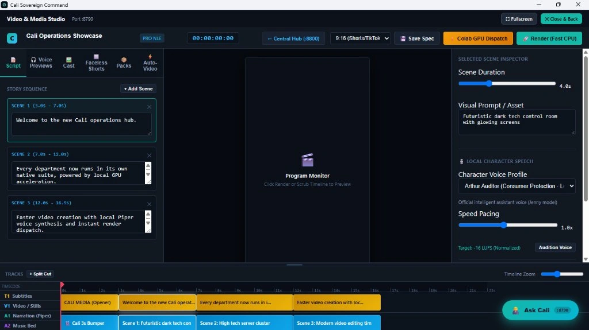
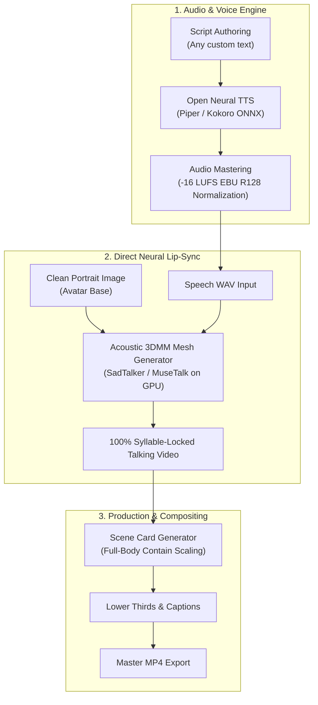

# Cali Video Studio 🎬🎙️

> **Free, self-hosted AI video creation & audio-driven neural lip-sync pipeline for creators.**  
> Create expressive talking avatars with 100% syllable-locked speech, zero cloud API fees, and zero credit limits.



---

## 🌟 Why Cali Video Studio?

Most AI video tools lock creators behind expensive credit meters, subscription paywalls, or closed generation APIs. Even worse, prompt-based video generators (like Google Flow Omni) synthesize their own arbitrary speech from text prompts—causing **severe mouth desync, speech onset delays, and unnatural post-speech flapping** when dubbing custom voices.

**Cali Video Studio solves this with an Audio-First "Say Anything" Architecture:**
1. **Author Any Script:** Write novel dialogue, technical guides, or tutorials without prompt restrictions or credit fees.
2. **Synthesize Clean Speech:** Generate natural character voices using local open-source neural TTS (Piper TTS, Kokoro ONNX, etc.) normalized to `-16 LUFS` broadcast loudness.
3. **Audio-Driven Neural Lip Sync:** Feed the character portrait base and the speech audio `.wav` directly into a neural talking-head pipeline (SadTalker / MuseTalk). The mouth shapes, jaw articulation, and head motion are driven directly by acoustic phonemes, ensuring **100% frame-accurate lip sync** with natural mouth closure during pauses.
4. **Automated Compositing:** Automated presentation card generation with full-body `contain` aspect ratio scaling (never cutting off heads or feet), dynamic lower thirds, and brand bumpers.

---

## 🏗️ Architecture



---

## 🚀 Quickstart: Google Colab (Free GPU)

You can run the neural audio-driven lip sync pipeline immediately on a free Google Colab T4 GPU without installing complex local machine learning packages.

1. Open [`colab/audio_driven_lipsync_quickstart.ipynb`](colab/audio_driven_lipsync_quickstart.ipynb) in Google Colab.
2. Set Runtime type: **Runtime > Change runtime type > GPU (T4)**.
3. Upload your character portrait (`.png` / `.jpg`) and your speech audio (`.wav`).
4. Click **Run All**. In under 2 minutes, download your finished, syllable-locked talking video!

---

## 💻 Local Studio Setup

### Prerequisites
* Python 3.10+ (or Docker)
* FFmpeg installed and available on your system `PATH`

### Installation

```bash
# Clone the repository
git clone https://github.com/Call-OnDad/cali-video-studio.git
cd cali-video-studio

# Set up virtual environment
python -m venv .venv

# On Linux/macOS:
source .venv/bin/activate
# On Windows:
.venv\Scripts\activate

# Install dependencies
pip install -r requirements.txt
```

---

## 🎙️ Voice & Audio Mastering Standard

In high-quality video production, erratic volume destroys user retention. Cali Video Studio includes an integrated EBU R128 loudness mastering utility:

```bash
python tools/audio_master.py --input speech.wav --output speech_mastered.wav --target-lufs -16.0
```

* **Standard Target:** `-16.0 LUFS` integrated loudness.
* **Peak Ceiling:** `-1.0 dBFS` to prevent clipping across mobile and web playback.

---

## 📐 Full-Body Framing Standard (No Head Cut-Offs)

When embedding character art into UI windows or presentation cards, center-cropping frequently cuts off the character's head or feet. 

The included scene generator (`tools/generate_scene_cards.py`) uses strict **contain scaling**:
```python
# Preserve complete aspect ratio with dark navy letterboxing
scale = min(art_w / raw_art.width, art_h / raw_art.height)
new_w = int(raw_art.width * scale)
new_h = int(raw_art.height * scale)
```
This guarantees the entire avatar—from hair crown to footwear—remains 100% visible and centered.

---

## 📂 Repository Layout

```
cali-video-studio/
├── README.md               # Main documentation & architecture guide
├── LICENSE                 # MIT Open Source License
├── requirements.txt        # Python dependency manifest
├── colab/                  # 1-Click Google Colab GPU notebooks
│   └── audio_driven_lipsync_quickstart.ipynb
├── docs/                   # In-depth architectural & implementation guides
│   ├── architecture.md
│   ├── voice_synthesis.md
│   └── audio_mastering.md
├── tools/                  # Production scripts & utilities
│   ├── audio_master.py     # EBU R128 loudness normalization (-16 LUFS)
│   └── generate_scene_cards.py # Card generator with contain scaling
└── studio/                 # Self-hosted web interface
    ├── app.py              # Studio application server
    └── static/             # Frontend assets and styling
```

---

## 🔒 Privacy & Clean Distribution

This repository is curated to be **100% clean and privacy-safe**:
* No proprietary mascot assets or private family voice identities are committed.
* All tools operate on standard open formats (`.wav`, `.png`, `.mp4`).
* Ready for any creator to bring their own artwork, open-source voice models, and scripts.

---

## 📄 Licence

Original studio code, compositing tools, and pipeline specifications are released under the [MIT Licence](LICENSE).
Third-party engines (SadTalker, Piper, Kokoro) retain their respective open-source licences.
